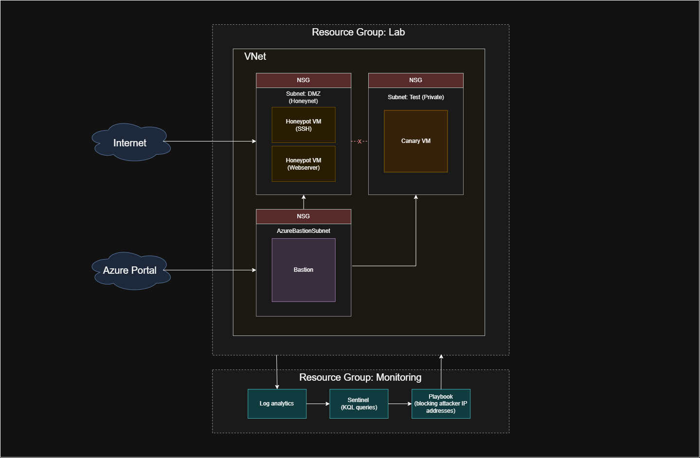

# Cybersecurity-Azure-Lab
I'm building this lab to practice using Microsoft Azure, networking, playbooks, bicep, KQL, basic governance with policies and RBAC, etc.

## Intro
This is a personal project that i am undertaking independently to learn how to properly use Azure and tools within Azure, including bicep, log analytics, KQL, Sentinel, Bastion, playbooks, Azure Policies and RBAC.

My aim is to make a honeynet containing a couple of flavours of honeypots, one honeypot will be a vulnerable web server, and the other will be a server with port 22 exposed to the internet. I will collect and analyse logs from the honeynet and create a playbook to block attacker IP addresses automatically.

Due to extremely tight cost restraints (I am working solely off the free £150 credit that Azure gives new users for 1 month) I will be using bicep to deploy/create the resources for this project, this is so I can tear everything down and only have resources deployed and running for short time periods when I want to actually collect and analyse logs, test the playbooks, etc.

## Overall architecture
### Resource group for the lab: 
This resource group will contain;
- Vnet with 3 subnets, 1 subnet for the honeynet, 1 subnet for a private internal network that shouldn't get compromised, and 1 for Azure Bastion.
- 2 NSGs, 1 for the honeynet subnet and 1 for the internal subnet.
- Outgoing traffic from the honeynet to the internal subnet will be blocked.
- Outgoing traffic from the internal subnet to the honeynet will be blocked.
- The honeynet subnet will have the two honeypots mentioned previously; 1 vulnerable web server, one server with port 22 exposed to the internet.
- The internal subnet will have 1 "canary" vm within it, this should not get attacked/compromised, if it does then I know I've done something wrong.

### Resource group for monitoring the lab
This resource group will contain;
- log analytics.
- Sentinel.
- Playbooks for blocking attacker IP addresses.

Not really sure on the details of this yet, I am working everything out as I go along.

Please see the Architecture diagram in this repository for a more clear overview.

